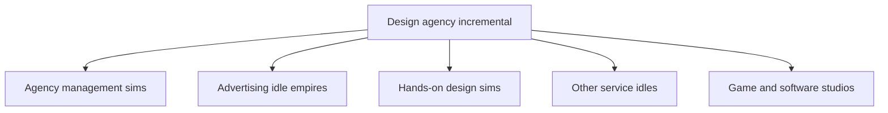

# Service Business Incremental Games

Direction, later the same day: advertising and marketing agencies are out of the concept. The working subject is a UI/UX and product-design studio that also sells leadership. The feel references, and why Design Studio Tycoon is the wrong length, are in [[Product Design Incremental]]. This note stays as the survey of what was checked.

Research date: 19 October 2026. This note reviews store pages and official sites, not hands-on play. A store description is evidence of what a developer advertises. It does not establish how the game feels, how long people play it, or whether it makes money.

Searches covered design agencies, advertising agencies, graphic and print studios, architecture firms, law firms, consulting, and idle or incremental games about client-service businesses. Sources were Steam, itch.io, Google Play, the App Store, and developer sites. This was a targeted pass, not a crawl of every mobile listing.

Two leads were set aside. An itch.io page titled Fincremental Studio did not resolve (404), so it is not treated as a released game. Website Design Tycoon on Game Jolt is marked "Not Coded Yet" and dated May 2014, so it is not treated as a shipped game. [Game Jolt](https://ssr.gamejolt.net/games/website-design-tycoon/26614)

## The question

Three kinds of game were kept separate:

- **Incremental / idle.** The advertised loop is upgrades, automation, offline earnings, or a reset that keeps a bonus. Progress is "numbers go up," including while the player is away.
- **Management simulation.** The player runs clients, staff, cash, and time inside a paced business. Time passing does not make it idle.
- **Hands-on craft.** The player personally makes the design, the ad, or the building.

The question was whether a design agency already exists as an incremental game, and, if not, which nearby games already occupy running a creative or client-service business.

## What turned up

No released incremental was verified whose subject is a design practice delivering client work: briefs, pitches, revisions, and a team. The nearest games split into three occupied roles.

- A **digital agency as a serious management sim** already exists. Pitch & Pixel is the clearest one, and its own page says it is not a casual tycoon.
- **Advertising as an idle empire** already exists. Idle Media Tycoon and Billboarders sell placements and formats. They do not advertise designing the work.
- **Doing the design yourself** already exists as a craft sim. Design Studio Simulator and Ad Agency Simulator put the player in an editor. They do not advertise an idle loop.

A five-minute browser game, Design Studio Tycoon, is the closest thing that is both a design studio and visibly an income-per-second game. Its author describes it as a rudimentary exercise in game mechanics.

## Design studios and agencies

| Game                                                                                                                                          | What the page says it is                                                                                                                                                                                                                                             | Advertised loop                                                                                                                                                                                                                                                                                                            | How it sits next to a design-agency incremental                                                                                                                                                                                                                                                              |
| --------------------------------------------------------------------------------------------------------------------------------------------- | -------------------------------------------------------------------------------------------------------------------------------------------------------------------------------------------------------------------------------------------------------------------- | -------------------------------------------------------------------------------------------------------------------------------------------------------------------------------------------------------------------------------------------------------------------------------------------------------------------------- | ------------------------------------------------------------------------------------------------------------------------------------------------------------------------------------------------------------------------------------------------------------------------------------------------------------ |
| **Pitch & Pixel** — Robert Kolloch, Steam, 21 Jun 2026                                                                                        | A single-player simulation of 30 years of digital-agency history. Paths include a small high-quality team, an agency group, an industry specialist, an award collector, or acquisitions.                                                                             | Sell and market across 11 channels, win a pitch against a market price, deliver projects by allocating hours, hire eight roles, and buy rivals or run them as subsidiaries. Crises include 2001, 2008, and 2020. The page says it will let an inattentive player go bankrupt, and that it is not a race against the clock. | The closest full depiction of running a digital agency. It is a paced strategy sim. [Steam](https://store.steampowered.com/app/4681270/Pitch__Pixel/)                                                                                                                                                        |
| **Ad Agency Tycoon** — BarCoffee Studio, Steam, full release 3 Feb 2025; Early Access 27 Jul 2020                                             | A 1960s advertising-agency simulator.                                                                                                                                                                                                                                | Choose campaign ingredients, see the resulting advertisement, read audience feedback, then spend money and reputation on staff, office assets, and a new office.                                                                                                                                                           | An ad agency as a management sim with a campaign-recipe minigame. The page does not describe automation, offline earnings, or a prestige reset. [Steam](https://store.steampowered.com/app/1298820/Ad_Agency_Tycoon/)                                                                                        |
| **Ad Agency Simulator** — DoDo Game, Steam Early Access, 29 Oct 2024                                                                          | Start in a small advertising office and design work for city businesses.                                                                                                                                                                                             | Design logos, signboards, and posters, deliver them, take revisions, and grow popularity. The Early Access note says competitions with other agencies are planned for the full version, not present now.                                                                                                                   | A hands-on ad-making sim. The page does not describe an idle loop. [Steam](https://store.steampowered.com/app/2701980/Ad_Agency_Simulator/)                                                                                                                                                                  |
| **AdvertCity** — VoxelStorm and Armchair Software, Steam, 17 Apr 2015                                                                         | A cyberpunk advertising tycoon.                                                                                                                                                                                                                                      | Place physical ads and post links in a procedural city, choose clients, hire staff, buy buildings, and watch the city economy respond. Single save.                                                                                                                                                                        | An advertising-empire sim from 2015. The page describes exploration and placement, not an incremental upgrade ladder. [Steam](https://store.steampowered.com/app/365800/AdvertCity/)                                                                                                                         |
| **Design Studio Simulator: Print Your Empire** — INKŌ Studio, Steam Early Access, 20 Aug 2026                                                 | A print-on-demand studio, from a spare room and an iron to a larger production studio.                                                                                                                                                                               | Take walk-in and online orders, design the product in an editor (text, stickers, styles, print zones), produce and deliver it, manage stock and reputation. The page says there is no punishing timer and no game-over screen. Era 1 and Era 2 are playable; Era 3 is planned.                                             | The closest "design studio" craft sim. The player is the maker. Clients notice mistakes. It is not advertised as idle. [Steam](https://store.steampowered.com/app/4824880/Design_Studio_Simulator_Print_Your_Empire/)                                                                                        |
| **Design Studio Tycoon** — Yash Banka, browser, described on his site as Jun 2026                                                             | A short studio game. The live page's visible copy: five minutes, one studio, hire, ship, survive the market, finish with the biggest book of business. The screen shows a clock, a balance, and an income-per-second figure. The default name offered is Pixel & Co. | A five-minute session with a leaderboard. The page shell does not spell out projects, clients, or upgrades beyond hire / ship / survive, so those details are not claimed here.                                                                                                                                            | The only verified design-studio game that shows an income-per-second counter. Banka writes that it is a rudimentary attempt, made to learn how to design and balance mechanics, not to ship a polished game. [Live page](https://studio-tycoon.yashbanka.com/) · [Author note](https://www.yashbanka.com/ai) |
| **Marketing Millionaire** — Vendero Media, Google Play, updated 14 Jun 2026                                                                   | A marketing agency, from a home office toward a downtown HQ and a stated goal of $1,000,000 in revenue.                                                                                                                                                              | Pitch clients by reading a personality, play small skill games for networking and campaigns, hire and train staff, and ride booms and recessions. The page says this is not just a clicker.                                                                                                                                | A marketing-agency game with skill gates on the sale. Adjacent service business. Not a design studio, and not advertised as idle earnings while away. [Google Play](https://play.google.com/store/apps/details?hl=en_US&id=com.venderoapps.marketingmillionaire)                                             |
| **Idle Media Tycoon** — Meher Jouini, App Store; version lines read 1.0.0 on 28 May and 1.0.1 on 15 Jul, and the copyright line includes 2026 | The page calls it an advertising-agency management game and an idle game.                                                                                                                                                                                            | Start with flyers. Climb formats: posters, billboards, blimps, TV, helicopters. Hire a team, win clients, run campaigns, expand cities, automate, and collect income while away. Sold with speed-up and currency packs.                                                                                                    | The closest released **advertising idle**. The thing that grows is the media ladder, not a design practice. The store had too few ratings to show a review summary when this page was read. [App Store](https://apps.apple.com/sb/app/idle-media-tycoon/id6771500562)                                        |
| **Billboarders: Idle Tycoon** — Soflare Games, Google Play, updated 7 Dec 2025                                                                | A 2D idle business sim about billboard advertising.                                                                                                                                                                                                                  | Unlock billboards, show sponsor ads, open regions, play minigames, and earn offline. The page says no internet is required.                                                                                                                                                                                                | Advertising as owned inventory. A placement business, not a studio that makes the ads. [Google Play](https://play.google.com/store/apps/details?hl=en_GB&id=com.soflaregames.billboarders)                                                                                                                   |

## Other client-service businesses

These sell work or attention for a client, or run a shop that serves people. They are included because a design agency is a service business even when the theme is not design.

| Game | What the page says it is | Advertised loop | How it sits next to a design agency |
| --- | --- | --- | --- |
| **Law Empire Tycoon** — Codigames, Google Play, updated 20 Nov 2025 | An idle game about a law firm. | Open departments by case type, hire lawyers, interns, detectives, receptionists, and delivery workers, upgrade equipment, and grow the office. The page addresses fans of management and idle games. | A professional-service idle on a familiar mobile template: rooms, staff, and case types as upgrade tracks. [Google Play](https://play.google.com/store/apps/details?hl=en&id=com.codigames.idle.law.empire.tycoon) |
| **Law Firm Simulator** — dizzy, Steam, listed for Q4 2026 | A 3D management sandbox. Not yet available. | Design the office, hire across six roles, move cases through six stages from investigation to closeout, watch cash and rivals. Solo practitioner or a firm that already has a team. | A forthcoming law-firm management sim. Useful as a picture of professional-service pacing. It is not an idle game, and it is not out. [Steam](https://store.steampowered.com/app/5066540/) |
| **Idle Barber Shop Tycoon** — Codigames, Google Play, updated 4 May 2026 | An idle barbershop, from inherited furniture toward a larger salon. | Unlock styles and tools, hire staff, upgrade the shop, and follow character stories. The page calls it an incremental and idle game. | The same service-shop template as Law Empire Tycoon, with haircuts instead of cases. Evidence that "serve customers, upgrade the room, hire help" is a crowded mobile pattern. [Google Play](https://play.google.com/store/apps/details?hl=en_US&id=com.codigames.idle.barber.shop.empire.tycoon) |
| **TV Empire Tycoon** — Codigames, Google Play | An idle TV studio. | Upgrade sets, cafeteria, aerials, control room, and departments such as news and weather; hire staff; the page says invested idle money changes the studio visually. | A media-production idle from the same developer family. Neighbor to an agency, still a facility-upgrade game. [Google Play](https://play.google.com/store/apps/details?hl=en&id=com.codigames.idle.tv.empire.tycoon) |
| **Influencer Agency: Go Viral** — Google Play | An idle clicker about a creator agency. | Tap for views, recruit creators by niche, upgrade gear, take brand deals through a negotiation minigame, manage stress, earn offline, and prestige for multipliers. | A talent agency as an incremental, including a prestige reset. The product is attention, not design deliverables. [Google Play](https://play.google.com/store/apps/details?hl=en&id=com.artistscompany.influencer_agency) |
| **Architect Life: A House Design Simulator** — Shine Research, published by Nacon, Steam, 19 Jun 2025 | A career running an architectural firm. | Model the house to a brief and a budget, specify finishes and systems, place furniture, pick subcontractors, and react to site problems. Career mode unlocks further specialities. | A service business where the player does the professional work by hand. Not idle. [Steam](https://store.steampowered.com/app/1296400/Architect_Life_A_House_Design_Simulator/) |
| **Big Ambitions** — Hovgaard Games, official site lists release 28 Aug 2026 | A business role-playing sandbox in New York. | Open many kinds of shop, including a law firm and a coffee shop, or "making millions developing websites." Rent, renovate, hire, stock, and buy buildings. | Service businesses appear here as one option inside a general entrepreneur sim. Website work is named, not built out on this page as an agency game. [Official site](https://www.bigambitionsgame.com/) |
| **Paradise Architect: Idle Tycoon** — zzeerr, Steam, 17 Nov 2023 | A city clicker. The page says click for money, then build residential, commercial, and industrial buildings. | Passive income from a growing city, plus timed infrastructure quests. | Included only because of the name. It is a city idle. It is not an architecture practice. [Steam](https://store.steampowered.com/app/2661940/Paradise_Architect_Idle_Tycoon/) |

A consulting-firm game did not turn up on a store page in this pass. That is a limit of the search, not a claim that none exists.

## Creative studios that make a product

Game and software studios are the crowded creative-business theme. They make a product and sell it. A design agency sells a service to a client's brief. Both hire specialists and ship work. The customer relationship is different.

| Game | What the page says it is | Advertised loop | Relation |
| --- | --- | --- | --- |
| **Game Dev Story** — Kairosoft, Steam 27 Mar 2022; the series is older on mobile | Manage a game company and try to ship a million-seller. | Hire and train staff, switch their professions, combine genres, develop a console. | The long-running studio-management template. Not idle. [Steam](https://store.steampowered.com/app/1847240/Game_Dev_Story/) |
| **Game Dev Tycoon** — Greenheart Games, Steam 29 Aug 2013 | Replay industry history from a garage in the 1980s. Greenheart says it started from a wish that Game Dev Story were less random and more about choices. | Research technology, combine topic and genre, pick platform and audience, grow a studio and a fan base. | The best-known studio sim of this type. Not idle. The development model, the staff defect rate, and the custom engine are read in [[Short Form Incremental Mechanics]]. [Greenheart](https://www.greenheartgames.com/app/game-dev-tycoon/) · [Steam](https://store.steampowered.com/app/239820/Game_Dev_Tycoon/) |
| **Game Dev Studio** — Explosive Squat Games, Steam 12 Mar 2018 | Run offices in the games industry. The page centres employees, engines, and more than one project at a time. | Hire by skill and topic knowledge. Build an engine, update it, and revamp it when the code is too messy. Run several teams or put everyone on one game. Rivals can hire your people away. | A studio sim whose advertised system rots and has to be rebuilt. The page is the source. The mechanical reading of that rebuild, next to this game's Machine, is in [[Short Form Incremental Mechanics]]. [Steam](https://store.steampowered.com/app/773580/Game_Dev_Studio/) |
| **Mad Games Tycoon 2** — Eggcode, Steam 31 May 2023; Early Access 21 Jan 2021 | A studio from 1976 onward, including publishing and console manufacture. | Build offices, hire, research, release many kinds of game, merchandise an IP, contract for publishers. | A wider studio sim. Not idle. [Steam](https://store.steampowered.com/app/1342330/Mad_Games_Tycoon_2/) |
| **Software Inc.** — Coredumping, Steam Early Access since 1 May 2015 | A software and hardware company, still in Early Access as a one-person project. | Design the building, hire specialists, ship products, take contracts, and compete in a simulated market. | A company sim about making software, with contract work as one option. Not idle. [Steam](https://store.steampowered.com/app/362620/Software_Inc/) |
| **Startup Company** — Hovgaard Games, Steam, 10 Apr 2020 | The CEO of a startup whose product is a website. | Develop features, grow hosting, run marketing, furnish the office, keep staff from leaving, buy competitors. | A product company, not a client-service agency. [Steam](https://store.steampowered.com/app/606800/Startup_Company/) |
| **It's Fine** — Buma Games, Steam, 23 Sep 2026 | An idle / incremental game about the last 24 hours of game-development crunch, with a dog as project manager. | Code and upgrade stations whose effects change as they grow, then prestige by sleeping to earn Sleephours and permanent upgrades. | Proof that a **creative-production idle** can be about the work rather than a shop counter. The fiction is crunching your own game, not serving a client's brief. [Steam](https://store.steampowered.com/app/3936270/Its_Fine/) |
| **Anime Biz Magnate** — Magnate Games, itch.io | The developer describes a management tycoon about running an animation studio: license or commission stories, hire individuals, fund a production, and live with rivals who have their own money. The page is also tagged Incremental. | Staff, funding, release windows, and rival studios. A free build is limited to 2 hours. | An animation-studio business sim. The Incremental tag is on the page; the written description is a management tycoon, so this note does not treat it as an idle clicker. [itch.io](https://magnate-games.itch.io/anime-biz-magnate) |

## The idle business pattern

AdVenture Capitalist, from Hyper Hippo, is the plain version of the business idle, and it is not a service agency. The Google Play page advertises a lemonade stand that becomes a conglomerate, managers who automate clicking, angel investors who boost profits after a reset, limited-time events, and money earned while the player is away eating or sleeping. [Google Play](https://play.google.com/store/apps/details?hl=en_US&id=com.kongregate.mobile.adventurecapitalist.google)

**Design interpretation, not a finding about any one game.** The service idles above (law, barber, TV, billboards, ad formats, influencers) keep that shape and change the nouns. A room or a format is an upgrade. A hire is automation. A new department is the next tier. Prestige, when it appears, multiplies the same climb. A design agency dropped onto that shape would be recognizable as another Codigames-style shop unless the brief, the pitch, the revision, and the retainer changed what the numbers mean.

It's Fine is the useful counter-example inside the incremental genre: stations change behavior instead of only adding a multiplier, and the prestige currency is sleep. That is still a game-jam crunch fantasy, not a client roster.

## What is already taken, and what was not found

**Already taken**

- Running a digital or advertising agency as a management sim, from the light campaign recipes of Ad Agency Tycoon to the market, pitches, retainers, and rivals of Pitch & Pixel.
- Personally producing the creative work: print products in Design Studio Simulator, logos and posters in Ad Agency Simulator, houses in Architect Life.
- Advertising as an idle of placements and formats: Idle Media Tycoon and Billboarders.
- Professional service as a mobile idle of rooms and staff: Law Empire Tycoon, and the same template for a barbershop and a TV studio.
- A talent agency as an incremental with offline earnings and prestige: Influencer Agency.
- Making games or software as the company's product, both as management sims and, in It's Fine, as an incremental.

**Not found in this pass**

- A released incremental whose fiction is a design practice: taking a brief, pitching, staffing the job, surviving revisions, and growing retainers.
- A consulting-firm game on a store page checked here.
- A polished design-studio idle. Design Studio Tycoon is a five-minute browser exercise with an income-per-second display, and its author says it exists to learn mechanics.

**Design interpretation.** The open question is not "can you set an idle game in an office." That has been done. The open question is whether an incremental can be about the service itself — the brief, the relationship, and the quality of the delivery — rather than a reskin of billboards, haircuts, or lemonade. Pitch & Pixel already answers the management-sim version of that question, and it answers it by refusing casual tycoon pacing. An incremental would have to justify a different pace on purpose.

No claim about audience size, revenue, or the chance of success follows from this review.

## Related

- [[Agency Index]]
- [[Product Design Incremental]]
- [[Short Form Incremental Mechanics]]
